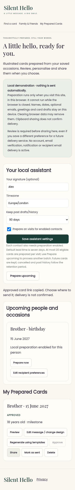
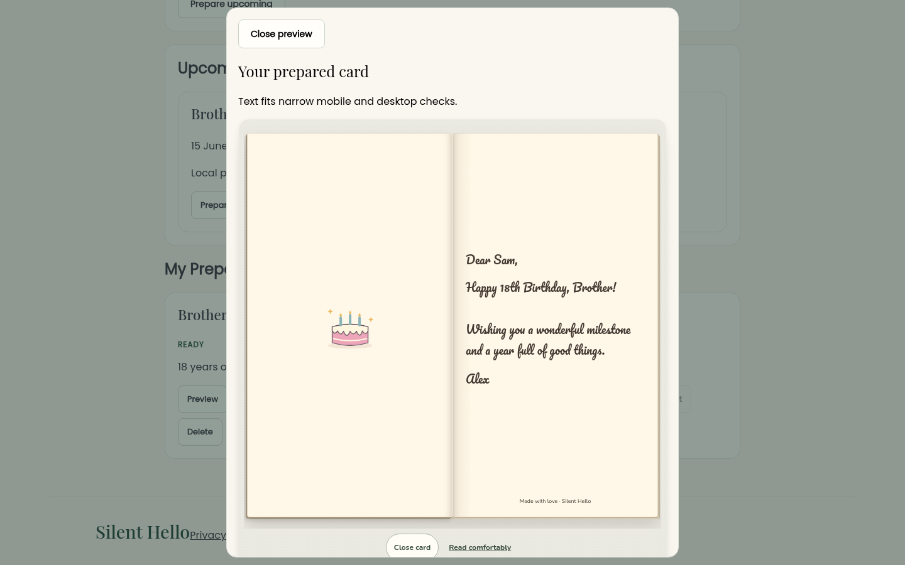
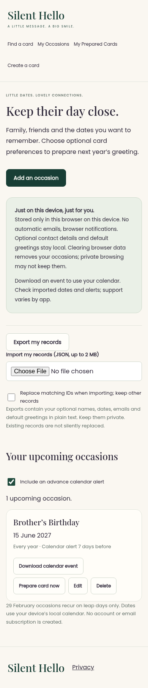

# Add a local personal card assistant

Saved birthdays and anniversaries can now prepare complete editable illustrated cards. A known birth year produces the correct age and milestone design: 15 June 2009 becomes an 18th birthday card for 15 June 2027. Unknown years never invent an age.

## Functionality

- Extend My Occasions with recipient preferences, optional origin year/email, existing designs, style/opening, greeting templates and per-contact preparation.
- Preserve v1 reminders with an authoritative validated v2 migration, private JSON import/export and explicit deletion cleanup.
- Opt-in local preparation on site visits, timezone-aware due windows, stable occurrence IDs, stale-edit detection, cancellation, failure states and configurable retention.
- My Prepared Cards supports preview, existing-editor edits, regeneration, approval, link sharing and manual sent history. Real mobile/desktop renderer fitting gates readiness; edits clear approval.
- Keep recipient opening, legacy v1–v5 codecs, physical card engine and existing photo runtime byte-identical. No duplicated photo assets or new artwork.

## Screenshots

## Executed validation

All 42 Node tests passed across data, occasions, photos and assistant. All existing Python suites ran: browser (24 groups), shop, interactive, physical, responsive, recipient, calendar parser, occasions and photo. New assistant end-to-end checks passed at 320/390/768/1440px, plus real storefront visit generation, date changes, deduplication and deleted-contact suppression. Independent ICS parsing remains passing.

The first photo run hit an existing envelope-animation timing timeout at 430px. A complete isolated rerun passed with no runtime/test changes. Actual logs: [test-results.txt](test-results.txt). Screenshot review corrected a scoped sender-preview sizing problem before the final passing run.

## Privacy and limitations

This is a local demonstration, off by default. It runs only on visits, at most 20 eligible preparations per visit; no closed-browser scheduling, accounts, notifications or email delivery is active. Browser data can be lost or read by other users of the same profile. Exported JSON contains private saved fields. Local sharing always requires review; recipient email is syntax-checked only. Sent is a manual record. LocalStorage is not a transactional multi-user backend.

Photo delivery remains PR #36's separate persistent-storage dependency; the assistant generates existing illustrated configurations. No merge, deployment, DNS changes, paid API or actual messages.

## Backend and next phase

[Compatibility audit](audit.md), [usage and migration details](README.md), and [Railway/FastAPI/PostgreSQL/Resend specification with explicit activation checklist](backend-plan.md).

Next implement authenticated owned data, transactional occurrence/revision uniqueness, timezone-aware jobs, durable outbox/retries, verified sender notifications, explicit approval and per-contact delivery consent, cancellation, opt-outs, retention and cost limits. Keep Silent Hello independent from EV Revival. Real unattended scheduling and delivery must pass the documented activation checklist first.
