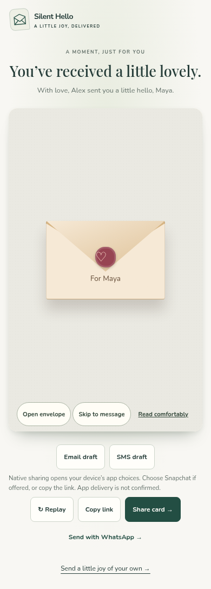
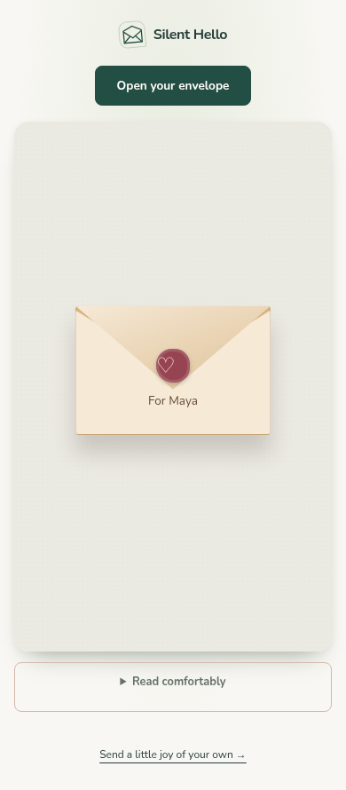
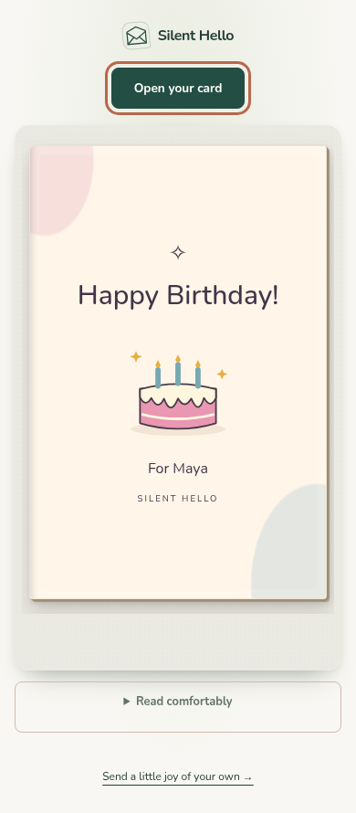
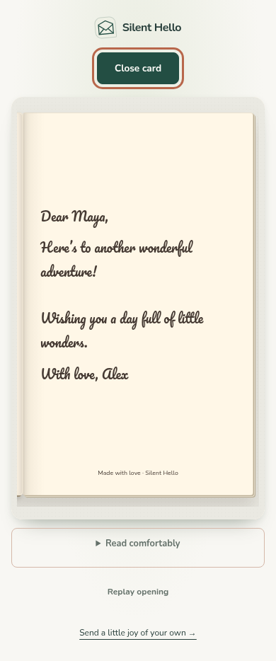
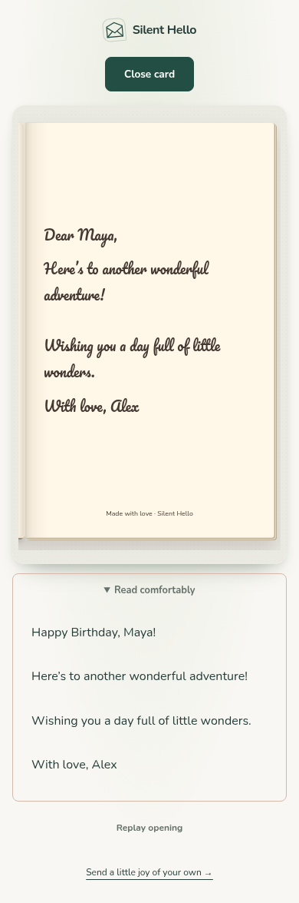

# Recipient page redesign

The recipient now sees a discreet Silent Hello brand, a single opening action above the card, and the personalised envelope. The action follows the existing envelope → cover → inside controller and becomes Close card inside. Closing retains the cover; replay returns to the envelope after the message has been opened.

Sender sharing tools and introductory copy are removed. Read comfortably preserves the full text and signature in a naturally scrolling, keyboard-accessible reading view. Skip remains available to assistive technology and keyboard users, and appears during animations. Existing animation implementations, reduced-motion handling, templates, link decoding and studio behavior are unchanged.

The recipient adopts the renderer's actual opening button into the parent document, retaining its existing click handler, disabled state and focus handoff. Recipient-only CSS is loaded by view.html; shared engine files are unchanged.

## Screenshots

| Before (390px) | After (390px) |
| --- | --- |
|  |  |

| Cover | Inside | Comfortable reading |
| --- | --- | --- |
|  |  |  |

Stage screenshots are also included at 320, 360, 412, 430, 768 and 1440px. Long-message coverage is in long-message.png.

## Validation

Run `node tests/data.mjs` and `python -u tests/{browser,shop,interactive,physical,responsive,recipient}.py` individually (the braces denote the six scripts).

The dedicated recipient suite exercises direct envelope/cover activation, the top button, keyboard activation, close/reopen, replay, comfortable reading, reduced motion, skip, full long messages, and real v1/v2 query and v3/v4/v5 fragment links. It checks horizontal bounds and the action's position above the iframe at every stage at 320, 360, 390, 412, 430, 768 and 1440px. It is included in CI alongside the existing suites.

Existing regression assertions for recipient sharing/intro copy were updated to assert their removal; the preview/recipient geometry equality assertion now checks recipient fit because the recipient has its own page spacing.
